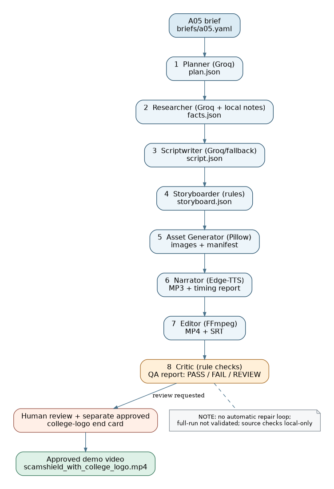

# ScamShield — Somaiya AgentReel Challenge (A05)

**Status:** Working awareness reel / pre-final documentation; full one-command generation not yet validated.  
**Topic:** Spotting fake internships and “digital arrest” scams.  
**Audience:** College students.  
**Repository:** https://github.com/rishimane-svg/agentic_ai_agentreel

## Deliverable and creative strategy

ScamShield is a ~53.26-second, English, vertical cyber-safety awareness reel. Its narrative moves from an opening hook to a fictional internship-fee request, an impersonation-based “digital arrest” call, protective actions, official reporting channels and an end-card disclosure. The sample scenarios are illustrative, not documented individual incidents. Do not imply that every internship asking for a fee is necessarily fraudulent.

**Approved video candidate:** `outputs/scamshield_with_college_logo.mp4`  
**Companion subtitles:** `outputs/scamshield_final_polish.srt`  
**Automated QA:** `outputs/qa_report.json` or `outputs/qa_orchestrator.json` (see dates/results).

## Architecture and agent roles



| Stage | File | Role/output | Implementation notes |
|---|---|---|---|
| Planner | `agents/planner.py` | Read A05 brief → `outputs/plan.json` | Groq LLM |
| Researcher | `agents/researcher.py` | Read curated official-source notes → `outputs/facts.json` | Evidence matched to local notes, not independent source-page verification |
| Scriptwriter | `agents/scriptwriter.py` | Write seven-scene script → `outputs/script.json` | Groq / fallback; final approved script was human revised |
| Storyboarder | `agents/storyboarder.py` | Map narration to timed scenes → `outputs/storyboard.json` | Rule-based |
| Asset Generator | `agents/asset_generator.py` | Draw seven 1080×1920 scene illustrations → `assets/images/` | Pillow programmatic graphics, not generative image model |
| Narrator | `agents/narrator.py` | TTS → `assets/audio/*.mp3`, timings → `outputs/narration_report.json` | Edge-TTS |
| Editor | `agents/editor.py` | Compose video/captions → MP4 and SRT | FFmpeg; approved logo end card added in a separate final edit, **not yet integrated into this script** |
| Critic | `agents/critic.py` | Inspect media, subtitles, claims metadata → QA report | Rule-based; marks manual checks REVIEW; no self-repair loop |

## Setup

Requirements: Python 3.9+, `ffmpeg` and `ffprobe`, dependencies in `requirements.txt`; Groq access for Planner/Researcher; Edge-TTS network access for narration. Local Ollama support may be available for script fallback.

```bash
python3 -m venv .venv
source .venv/bin/activate
python -m pip install -r requirements.txt
cp .env.example .env
# Fill in GROQ_API_KEY locally; never commit .env or reveal its contents.
```

## Tested commands (do not regenerate approved reel)

```bash
python run.py --mode check
python run.py --mode qa --brief briefs/a05.yaml --seed 42
# Or run Critic directly:
python -m agents.critic --video outputs/scamshield_with_college_logo.mp4 --srt outputs/scamshield_final_polish.srt
```

`--mode check` passed. `--mode qa` executed and produced a report but **overall QA was FAIL** because measured integrated loudness was around −21 LUFS vs the handout's ~−14 LUFS target. Human review items remain open.

**Full-generation mode (experimental):** `python run.py --mode full --allow-regenerate --brief briefs/a05.yaml --seed 42`. Run only in a separate disposable copy, as it calls LLM services and overwrites generated artifacts. In integration testing, the Planner and Researcher ran, but the Scriptwriter failed on a missing topic category. A subsequent attempted patch in the *test copy only* introduced an indentation error. Thus **complete end-to-end regeneration has NOT been demonstrated**; do not claim L3/L4 autonomy or an autonomous Critic repair loop. The approved final MP4 cannot currently be reproduced exactly from `run.py`, because its college-logo edit was performed separately.

## Demonstrated outcomes and QA

- Latest approved video: ~53.261 s, 1080×1920, 25 fps, H.264 High, `yuv420p`, AAC stereo at 48 kHz; ~1.54 MB.
- Critic output observed: **14 PASS, 1 FAIL, 10 REVIEW**. Failure: integrated loudness −21.0 LUFS vs ~−14 LUFS target; true peak −7.7 dBFS (no detected clipping).
- SRT: 13 cues; timestamps passed automated bounds/overlap checks. Actual word synchronization and mobile readability still require human review.
- Known layout caveat: decorative header encroaches on top 250 px platform UI safe zone; accepted for the demo but not fully compliant with the written specification.
- Source-grounding limitation: quoted excerpts match curated `data/sources/cyber_safety_notes.md`; an independent check of all source originals, and asset/logo authorization, remain a review task.

## Responsible AI and provenance

The awareness content avoids real victim likenesses and uses fictitious UI examples. `cybercrime.gov.in` is the Indian National Cyber Crime Reporting Portal, while **1930 is primarily for financial cyber fraud reporting**. Check all published wording against the original official advisory, not only the curated notes. The end card contains `Created with AI agents — LY Agentic AI Lab`. A human reviewed and revised the script, timing and end card. The visual assets are programmatically created, not image-model generations. The system is **supervised AI-assisted production with partially tested orchestration**; autonomy level cannot be honestly reported as L3 or L4. Document all known human interventions, not just the automated run.

## Logs, costs and reproducibility

`logs/run_log.jsonl` and `logs/orchestrator_run_log.jsonl` contain available historic stage evidence, but they are not known to constitute an exhaustive record of every model/tool call. Individual agents may log provider token usage; historical cost values must be derived from genuine measured usage or marked **unknown**, never estimated as observed. The `--seed` flag does not guarantee deterministic Groq/Edge-TTS output.

## Submission readiness / outstanding work

- [ ] Confirm approved faculty logo and license/provenance in `assets/manifest.csv`.
- [ ] Complete official-source review and document final human Category A safety approval.
- [ ] Validate real mobile caption readability and disclosure; optionally address top safe zone and loudness deviation.
- [ ] Populate `logs/cost_report.csv`, `logs/interventions.md` from genuine evidence.
- [ ] Organize prompt templates in `prompts/` from the actual agent source files.
- [ ] Fill in final Team ID, rename final files `TeamID_A05_final.mp4` / `.srt`, and confirm rubric compliance.
- [ ] Replace this status with a tested final summary, commit, then tag `v1.0-final` **only when submission is ready**.

## Related documents

- `docs/agent_graph.png` — architecture/handoff diagram.
- `docs/process_report.pdf` — concise report, explicitly marked as a pre-submission draft.
- `docs/process_report.md` — editable source for the report.
